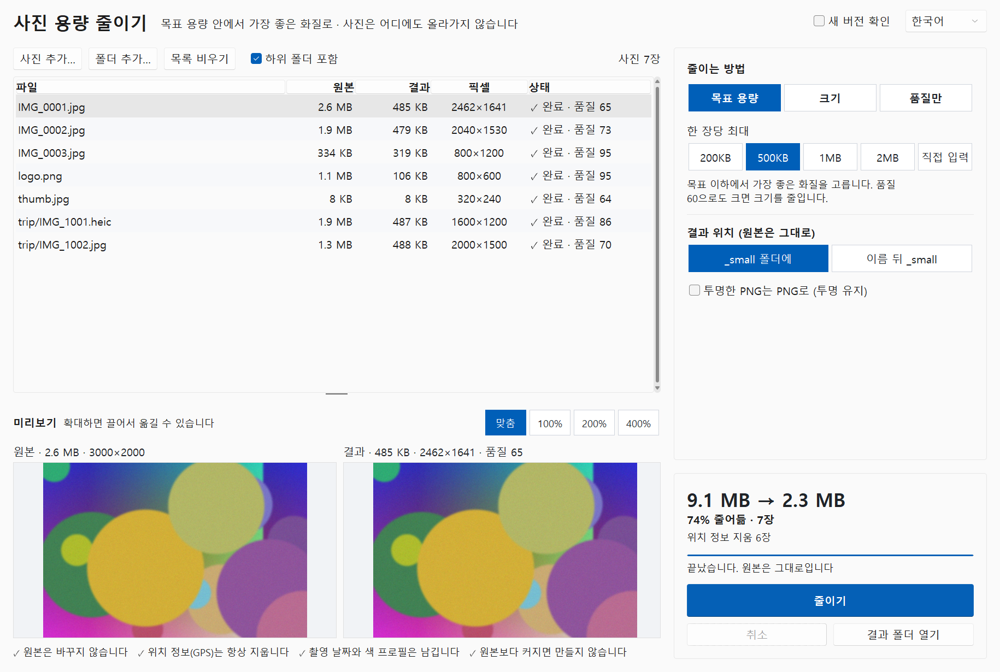
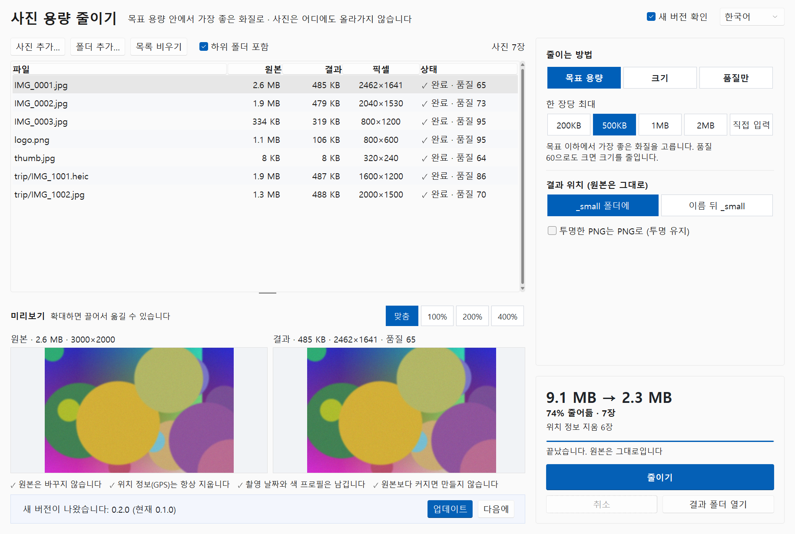

# Photo Resize (사진 용량 줄이기)


[한국어](README.md) · [日本語](README.ja.md) · [简体中文](README.zh-CN.md)

> **Your photos never leave your PC.** Everything happens locally (except the update check — tool name and version only, once a day, can be turned off).
> **Originals are never changed.** Results are new files in a `_small` folder.
> **Location (GPS) is always removed.**

A Windows program that shrinks photos **to the best quality that still fits a size limit** such as "under 500 KB" — for job, government, school and shop sites that cap uploads at 1 MB, mail attachments and chat apps. Many photos or whole folders at once; iPhone HEIC included.



## Download

- **Executable**: get `photo-resize.exe` from [Releases](https://github.com/microhan1/photo-resize/releases) and double-click. No installation. (The exe is not signed; if SmartScreen warns, choose "More info → Run anyway".)
- **From source** (Python 3.12 or newer):

```bash
pip install -r requirements.txt
python main.py
```

## How to use

1. Drop photos or folders on the window (or **Add photos… / Add folder…**).
2. Choose how to shrink on the right. The default is **Target size 500KB**. The expected sizes appear at once (the first 3 photos are really shrunk to estimate). Pick a photo to compare the original and the result side by side at the same scale (zoom to 100%, 200%, 400% and drag).
3. Press **Shrink**. A summary such as "7 photos · 9.1 MB → 2.3 MB · location removed from 6" follows; **Open results** shows the files.

| Method | You choose | What it does |
| --- | --- | --- |
| **Target size** (default) | 200KB · 500KB · 1MB · 2MB · custom | For each photo, the **highest quality** under the target. Quality goes down first (95 → 60); if quality 60 is still too big, the long edge gets shorter. |
| Dimensions | long edge 3840 · 2560 · 1920 · 1280 · 800 px | Keeps proportions, never enlarges. Quality 85. |
| Quality only | high 85 · medium 75 · small 60 | Same pixel size, for freeing disk space. |

- 1 KB is counted as 1000 bytes, so a result fits whether a site counts in 1000s or 1024s.
- A photo that cannot reach a (very small) target is marked **Over target** and the smallest version made is kept.
- A result that would be **bigger than the original is not made** ("Already small").

## Where results go

| Save to | Example |
| --- | --- |
| In a `_small` folder (default) | `Trip\day1\IMG_1.jpg` → `Trip\_small\day1\IMG_1.jpg` (folder structure kept) |
| Name + `_small` | `Trip\day1\IMG_1.jpg` → `Trip\day1\IMG_1_small.jpg` |

- Nothing is ever overwritten: an existing name gets a number, `IMG_1 (2).jpg`.
- Results are JPG. Transparent PNGs are put on white; with **Keep transparent PNGs as PNG** they stay PNG with their transparency (smaller gain). A PNG with no transparent pixel at all, such as a screenshot, still becomes JPG.
- Running again never reads the `_small` folder or `_small` files as input.
- Accepted: JPG · PNG · HEIC/HEIF · WebP · BMP · TIFF.

## Photo information (EXIF)

| Information | In the result |
| --- | --- |
| Location (GPS) | **Always removed** (EXIF GPS, and XMP, which may also hold it) |
| Rotation | Applied to the pixels — the photo never shows up sideways elsewhere |
| Capture date, camera | Kept |
| Colour profile (ICC) | Kept (iPhone Display P3 too) |
| File modified time | Same as the original |

## Command line

```bash
python main.py D:\Photos --target 1MB
python main.py D:\Photos\a.jpg D:\Photos\b.heic --mode size --size 1920 --output suffix
python main.py D:\Photos --mode quality --quality medium --no-recursive
```

Options: `--mode target|size|quality`, `--target 500KB`, `--size 1920`, `--quality high|medium|low|60-95`, `--output folder|suffix`, `--keep-png`, `--no-recursive`, `--lang ko|en|zh-CN|ja`, `--version`. Exit codes: 0 success, 1 some photos failed, 2 nothing to shrink.

## Update check

At start the program sends only its name (`photoresize`) and version to the Chaekgalpi server (chaekgalpi.co.kr) to see whether a newer version exists. No file or photo is sent, it asks once a day, and **Check for updates** (top right) turns it off. The check runs in the background after the window opens; without a connection nothing is shown.

When a newer version exists, one line appears at the bottom of the window. **Update** opens the Chaekgalpi tools page; **Later** hides that version for good. Nothing is downloaded or replaced automatically.



*Picture: the notice line, shown with a faked server answer (new version 0.2.0).*

## Feedback

Tell us what's broken or missing with **Send feedback** (top right of the window) or at <https://chaekgalpi.co.kr/en/tools/photoresize#feedback> — no sign-in needed. The link only opens that page in your browser; the program itself sends nothing (the address carries the program's version). [GitHub Issues](https://github.com/microhan1/photo-resize/issues) are welcome too.


*Picture: the top right of the window (Korean screen): Send feedback (의견 보내기), Check for updates, language.*

## What it does not do

- No videos.
- No AI upscaling, background removal, ID-photo sizing, renaming, cropping or retouching.
- No WebP output (many upload sites refuse it; a v0.2 candidate).
- No uploading. Originals are never deleted or overwritten.
- No automatic download or replacement of new versions.

## Series

- Chaekgalpi Tools: [Photo Organizer](https://github.com/microhan1/photo-organizer) · [Music Folder Organizer](https://github.com/microhan1/music-folder-organizer) · [Music Tag Filler](https://github.com/microhan1/music-tag-filler)
- [Chaekgalpi Library](https://chaekgalpi.co.kr/tools/photoresize?utm_source=github&utm_medium=referral&utm_campaign=tool_cta&utm_content=photoresize) — a web service for logging the books you read.

## License

The code in this repository is MIT ([LICENSE](LICENSE)). HEIC is read with **pi-heif**, the read-only build of pillow-heif, so the GPLv2 x265 encoder is not in `photo-resize.exe`. The HEIC decoding libraries it does carry, libheif and libde265, are **LGPL-3.0**.

- They stay separate DLLs inside the exe; with this repository's source and `build.bat` you can rebuild the exe with other versions of them.
- The license texts are in `licenses/` (also inside the exe).
- Libraries and where their source is: [THIRD_PARTY_LICENSES.md](THIRD_PARTY_LICENSES.md)

Libraries used: Pillow, pi-heif (libheif, libde265), piexif, sv-ttk, tkinterdnd2.
