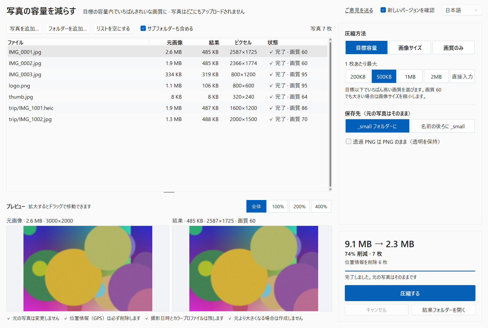

# 写真の容量を減らす (Photo Resize / 사진 용량 줄이기)


[한국어](README.md) · [English](README.en.md) · [简体中文](README.zh-CN.md)

> **写真が PC の外に出ることはありません。** 処理はすべてこの PC の中で行います（新しいバージョンの確認だけは例外で、送るのはツール名とバージョンだけ、1 日 1 回、オフにもできます）。
> **元の写真は変更しません。** 結果は `_small` フォルダーに新しいファイルとして作ります。
> **位置情報（GPS）は必ず削除します。**

「500 KB 以下」のような容量の上限に収まる範囲で、**いちばんきれいな画質に写真を圧縮する** Windows 用プログラムです。アップロードが 1 MB までに制限された求人・行政・学校・ショップのサイト、メールの添付、チャットアプリなどに。多くの写真やフォルダーをまとめて処理でき、iPhone の HEIC にも対応しています。



## ダウンロード

- **実行ファイル**: [Releases](https://github.com/microhan1/photo-resize/releases) から `photo-resize.exe` をダウンロードしてダブルクリック。インストールは不要です（exe には署名がありません。SmartScreen の警告が出たら「詳細情報 → 実行」を選んでください）。
- **ソースから**（Python 3.12 以上）:

```bash
pip install -r requirements.txt
python main.py
```

## 使い方

1. 写真やフォルダーをウィンドウにドラッグ＆ドロップします（または **写真を追加… / フォルダーを追加…**）。
2. 右側で圧縮方法を選びます。既定は **目標容量 500KB** です。予想サイズがすぐに表示されます（最初の 3 枚を実際に圧縮して予想します）。写真を選ぶと、元画像と結果を同じ倍率で並べて比べられます（100%・200%・400% に拡大してドラッグ）。
3. **圧縮する** を押します。「7 枚 · 9.1 MB → 2.3 MB · 位置情報を削除 6 枚」のようなまとめが表示され、**結果フォルダーを開く** でファイルを確認できます。

| 方法 | 選ぶもの | 内容 |
| --- | --- | --- |
| **目標容量**（既定） | 200KB · 500KB · 1MB · 2MB · 直接入力 | 写真ごとに、目標以下で**いちばん高い画質**を選びます。まず画質を下げ（95 → 60）、画質 60 でもまだ大きい場合は長辺を短くします。 |
| 画像サイズ | 長辺 3840 · 2560 · 1920 · 1280 · 800 px | 縦横比を維持し、拡大はしません。画質 85。 |
| 画質のみ | 高 85 · 標準 75 · 小さめ 60 | ピクセル数はそのまま。ディスクの空きを増やしたいときに。 |

- 1 KB は 1000 バイトとして数えます。サイトが 1000 単位でも 1024 単位でも、結果は上限に収まります。
- （とても小さい）目標に届かない写真は **目標超過** と表示し、作れたうちでいちばん小さいものを残します。
- 結果が**元画像より大きくなる場合は作成しません**（「すでに小さい」）。

## 保存先

| 保存先 | 例 |
| --- | --- |
| `_small` フォルダーに（既定） | `旅行\1日目\IMG_1.jpg` → `旅行\_small\1日目\IMG_1.jpg`（フォルダー構成を維持） |
| 名前の後ろに `_small` | `旅行\1日目\IMG_1.jpg` → `旅行\1日目\IMG_1_small.jpg` |

- 上書きは一切しません。同じ名前があれば番号を付けます（`IMG_1 (2).jpg`）。
- 結果は JPG です。透過 PNG は白い背景に載せます。**透過 PNG は PNG のまま** をオンにすると、透明を保ったまま PNG で保存します（小さくなる幅は控えめ）。スクリーンショットのように透明なピクセルがまったくない PNG は JPG になります。
- もう一度実行しても、`_small` フォルダーや `_small` のファイルは入力として読み込みません。
- 対応形式: JPG · PNG · HEIC/HEIF · WebP · BMP · TIFF。

## 写真の情報（EXIF）

| 情報 | 結果では |
| --- | --- |
| 位置情報（GPS） | **必ず削除**（EXIF の GPS と、位置を含むことがある XMP） |
| 回転 | ピクセルに反映 — ほかのアプリで横向きに表示されることはありません |
| 撮影日時・カメラ | 残します |
| カラープロファイル（ICC） | 残します（iPhone の Display P3 も） |
| ファイルの更新日時 | 元の写真と同じ |

## コマンドライン

```bash
python main.py D:\Photos --target 1MB
python main.py D:\Photos\a.jpg D:\Photos\b.heic --mode size --size 1920 --output suffix
python main.py D:\Photos --mode quality --quality medium --no-recursive
```

オプション: `--mode target|size|quality`, `--target 500KB`, `--size 1920`, `--quality high|medium|low|60-95`, `--output folder|suffix`, `--keep-png`, `--no-recursive`, `--lang ko|en|zh-CN|ja`, `--version`。終了コード: 0 成功、1 一部の写真が失敗、2 圧縮する写真がない。

## 新しいバージョンの確認

起動時に、プログラム名（`photoresize`）とバージョンだけを Chaekgalpi のサーバー（chaekgalpi.co.kr）に送り、新しいバージョンがあるかを確認します。ファイルや写真は一切送りません。確認は 1 日 1 回で、右上の **新しいバージョンを確認** でオフにできます。確認はウィンドウが開いたあとバックグラウンドで行い、ネットにつながっていなければ何も表示しません。

新しいバージョンがあると、ウィンドウの下に 1 行のお知らせが出ます。**更新** で Chaekgalpi のツールページを開き、**後で** でそのバージョンのお知らせを今後表示しません。自動でダウンロードしたり置き換えたりはしません。


*図: お知らせの行（韓国語画面）。サーバーの応答を偽装して表示（新しいバージョン 0.2.0）。*

## ご意見

不具合やほしい機能は、ウィンドウ右上の **ご意見を送る**、または <https://chaekgalpi.co.kr/en/tools/photoresize#feedback> からお知らせください（ログイン不要、英語のページです）。リンクはブラウザーでそのページを開くだけで、プログラム自体は何も送りません（アドレスにはプログラムのバージョンが入ります）。[GitHub Issues](https://github.com/microhan1/photo-resize/issues) も歓迎します。


*図: ウィンドウの右上（韓国語画面）: ご意見を送る（의견 보내기）、新しいバージョンを確認、言語。*

## できないこと

- 動画は扱いません。
- AI による高解像度化、背景の除去、証明写真のサイズ合わせ、名前の変更、切り抜き、レタッチはしません。
- WebP では出力しません（受け付けないアップロードサイトが多いため。v0.2 の候補）。
- アップロードはしません。元の写真を削除・上書きすることもありません。
- 新しいバージョンを自動でダウンロード・置き換えはしません。

## シリーズ

- Chaekgalpi Tools: [Photo Organizer](https://github.com/microhan1/photo-organizer) · [Music Folder Organizer](https://github.com/microhan1/music-folder-organizer) · [Music Tag Filler](https://github.com/microhan1/music-tag-filler)
- [Chaekgalpi Library](https://chaekgalpi.co.kr/tools/photoresize?utm_source=github&utm_medium=referral&utm_campaign=tool_cta&utm_content=photoresize) — 読んだ本を記録するウェブサービス。

## ライセンス

このリポジトリのコードは MIT です（[LICENSE](LICENSE)）。HEIC は pillow-heif の読み取り専用版 **pi-heif** で読むため、GPLv2 の x265 エンコーダーは `photo-resize.exe` に入っていません。exe に含まれる HEIC デコード用ライブラリ libheif と libde265 は **LGPL-3.0** です。

- これらは exe の中で独立した DLL のままです。このリポジトリのソースと `build.bat` を使えば、別のバージョンのライブラリで exe を作り直せます。
- ライセンス全文は `licenses/` にあります（exe の中にも入っています）。
- ライブラリとソースの入手先: [THIRD_PARTY_LICENSES.md](THIRD_PARTY_LICENSES.md)

使用ライブラリ: Pillow, pi-heif (libheif, libde265), piexif, sv-ttk, tkinterdnd2。
