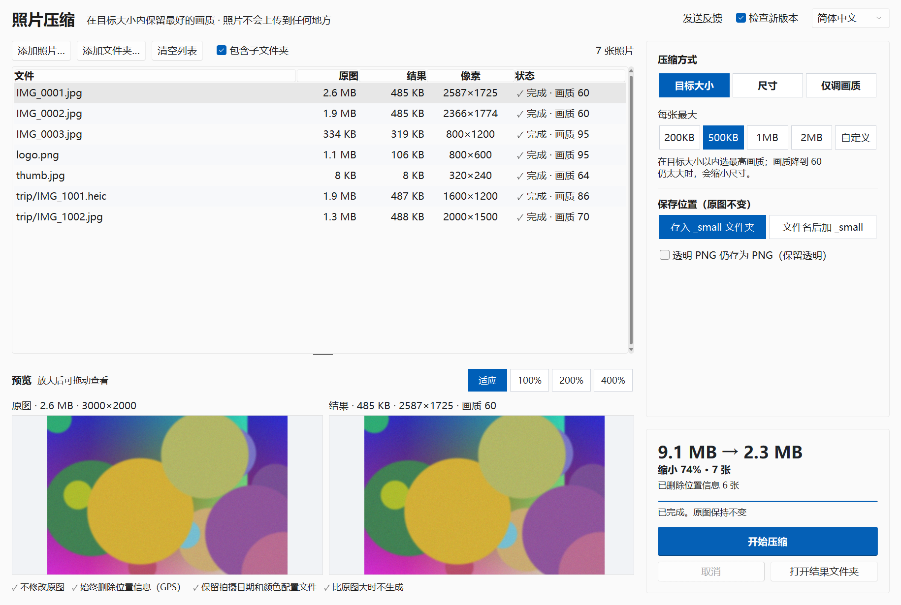

# 照片压缩 (Photo Resize / 사진 용량 줄이기)


[한국어](README.md) · [English](README.en.md) · [日本語](README.ja.md)

> **照片不会离开你的电脑。** 所有处理都在本机完成（唯一的例外是检查新版本：只发送工具名和版本号，每天一次，可以关闭）。
> **不修改原图。** 结果作为新文件保存在 `_small` 文件夹中。
> **始终删除位置信息（GPS）。**

一款 Windows 程序，在“500 KB 以内”这类大小限制下，**以尽可能好的画质压缩照片**。适合上传限制为 1 MB 的招聘、政务、学校和网店网站，以及邮件附件和聊天软件。可以一次处理大量照片或整个文件夹，也支持 iPhone 的 HEIC。



## 下载

- **可执行文件**：从 [Releases](https://github.com/microhan1/photo-resize/releases) 下载 `photo-resize.exe`，双击即可运行，无需安装。（exe 没有数字签名；如果 SmartScreen 发出警告，请选择“更多信息 → 仍要运行”。）
- **从源码运行**（Python 3.12 或更高版本）：

```bash
pip install -r requirements.txt
python main.py
```

## 使用方法

1. 把照片或文件夹拖到窗口上（或点 **添加照片… / 添加文件夹…**）。
2. 在右侧选择压缩方式。默认是 **目标大小 500KB**。预计大小会立即显示（实际压缩前 3 张照片来估算）。选中一张照片，可以按相同比例并排比较原图和结果（可放大到 100%、200%、400% 并拖动）。
3. 点 **开始压缩**。之后会显示“7 张 · 9.1 MB → 2.3 MB · 已删除位置信息 6 张”这样的汇总，点 **打开结果文件夹** 即可查看文件。

| 方式 | 可选项 | 说明 |
| --- | --- | --- |
| **目标大小**（默认） | 200KB · 500KB · 1MB · 2MB · 自定义 | 每张照片都在目标以内选**最高画质**。先降低画质（95 → 60），画质 60 仍然太大时，再缩短长边。 |
| 尺寸 | 长边 3840 · 2560 · 1920 · 1280 · 800 px | 保持比例，不放大。画质 85。 |
| 仅调画质 | 高 85 · 中 75 · 较小 60 | 像素尺寸不变，用于腾出磁盘空间。 |

- 1 KB 按 1000 字节计算，无论网站按 1000 还是 1024 计算，结果都不会超限。
- 达不到（非常小的）目标的照片会标为 **超出目标**，并保留生成过的最小版本。
- 结果**比原图大时不生成**（“已经够小”）。

## 保存位置

| 保存位置 | 示例 |
| --- | --- |
| 存入 `_small` 文件夹（默认） | `旅行\第1天\IMG_1.jpg` → `旅行\_small\第1天\IMG_1.jpg`（保持文件夹结构） |
| 文件名后加 `_small` | `旅行\第1天\IMG_1.jpg` → `旅行\第1天\IMG_1_small.jpg` |

- 绝不覆盖任何文件：已有同名文件时会加上编号，如 `IMG_1 (2).jpg`。
- 结果为 JPG。透明 PNG 会铺上白色背景；勾选 **透明 PNG 仍存为 PNG** 后，会保留透明并存为 PNG（压缩幅度较小）。截图这类完全没有透明像素的 PNG 仍会转为 JPG。
- 再次运行时，不会把 `_small` 文件夹或 `_small` 文件当作输入。
- 支持格式：JPG · PNG · HEIC/HEIF · WebP · BMP · TIFF。

## 照片信息（EXIF）

| 信息 | 在结果中 |
| --- | --- |
| 位置信息（GPS） | **始终删除**（EXIF 中的 GPS，以及可能也含有位置的 XMP） |
| 旋转 | 应用到像素上——在其他软件里也不会横着显示 |
| 拍摄日期、相机 | 保留 |
| 颜色配置文件（ICC） | 保留（包括 iPhone 的 Display P3） |
| 文件修改时间 | 与原图相同 |

## 命令行

```bash
python main.py D:\Photos --target 1MB
python main.py D:\Photos\a.jpg D:\Photos\b.heic --mode size --size 1920 --output suffix
python main.py D:\Photos --mode quality --quality medium --no-recursive
```

选项：`--mode target|size|quality`、`--target 500KB`、`--size 1920`、`--quality high|medium|low|60-95`、`--output folder|suffix`、`--keep-png`、`--no-recursive`、`--lang ko|en|zh-CN|ja`、`--version`。退出代码：0 成功，1 部分照片失败，2 没有要压缩的照片。

## 检查新版本

启动时，程序只把它的名称（`photoresize`）和版本号发送到 Chaekgalpi 服务器（chaekgalpi.co.kr），查询是否有新版本。不会发送任何文件或照片，每天只查询一次，右上角的 **检查新版本** 可以关闭此功能。查询在窗口打开后于后台进行；没有网络时什么也不显示。

有新版本时，窗口底部会出现一行提示。**更新** 会打开 Chaekgalpi 工具页面；**稍后** 会让这个版本的提示不再出现。不会自动下载或替换。


*图：提示行（韩语界面），使用模拟的服务器响应显示（新版本 0.2.0）。*

## 反馈

有问题或想要的功能，请通过窗口右上角的 **发送反馈**，或在 <https://chaekgalpi.co.kr/en/tools/photoresize#feedback> 告诉我们（无需登录，英文页面）。这个链接只是在浏览器中打开该页面，程序本身不发送任何内容（网址中带有程序的版本号）。也欢迎使用 [GitHub Issues](https://github.com/microhan1/photo-resize/issues)。


*图：窗口右上角（韩语界面）：发送反馈（의견 보내기）、检查新版本、语言。*

## 不提供的功能

- 不处理视频。
- 不做 AI 放大、去背景、证件照尺寸调整、重命名、裁剪或修图。
- 不输出 WebP（很多上传网站不接受；v0.2 的候选功能）。
- 不上传。也绝不删除或覆盖原图。
- 不自动下载或替换新版本。

## 系列

- Chaekgalpi Tools：[Photo Organizer](https://github.com/microhan1/photo-organizer) · [Music Folder Organizer](https://github.com/microhan1/music-folder-organizer) · [Music Tag Filler](https://github.com/microhan1/music-tag-filler)
- [Chaekgalpi Library](https://chaekgalpi.co.kr/tools/photoresize?utm_source=github&utm_medium=referral&utm_campaign=tool_cta&utm_content=photoresize)——记录读过的书的网络服务。

## 许可证

本仓库的代码采用 MIT 许可证（[LICENSE](LICENSE)）。HEIC 使用 pillow-heif 的只读版 **pi-heif** 读取，因此 GPLv2 的 x265 编码器不在 `photo-resize.exe` 中。exe 中包含的 HEIC 解码库 libheif 和 libde265 采用 **LGPL-3.0**。

- 它们在 exe 中仍是独立的 DLL；使用本仓库的源码和 `build.bat`，可以换用这些库的其他版本重新构建 exe。
- 许可证全文在 `licenses/` 中（exe 内也有）。
- 各库及其源码地址：[THIRD_PARTY_LICENSES.md](THIRD_PARTY_LICENSES.md)

使用的库：Pillow、pi-heif（libheif、libde265）、piexif、sv-ttk、tkinterdnd2。
